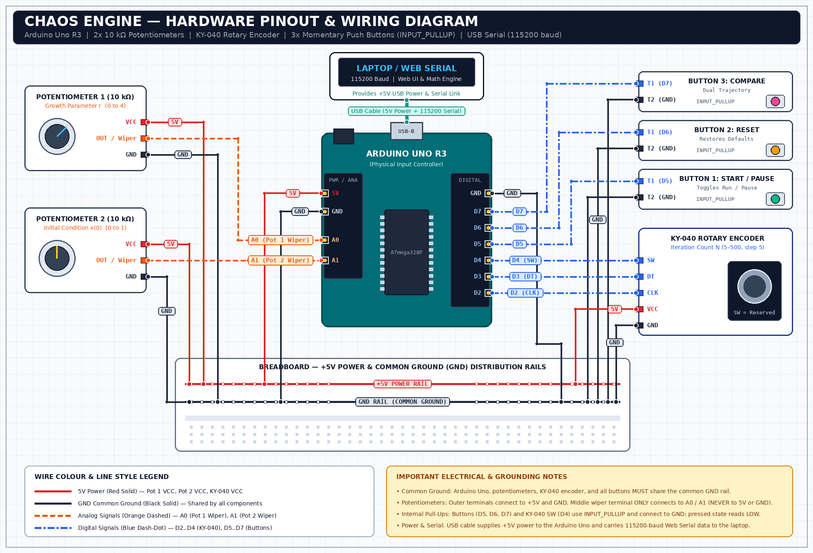

# ⚡ CHAOS ENGINE — Logistic Map Machine
### Interactive Physical Mathematics Exhibition & Real-Time Dynamical Systems Lab

[](https://chaos-engine-snowy.vercel.app)
[](https://notfound77.github.io/chaos-engine/)


**Live Production URLs:**
- **Vercel**: [https://chaos-engine-snowy.vercel.app](https://chaos-engine-snowy.vercel.app)
- **GitHub Pages**: [https://notfound77.github.io/chaos-engine/](https://notfound77.github.io/chaos-engine/)

**Created by**: **Binnisha Ghosh** & **Baidik Das**

**CHAOS ENGINE** is an interactive scientific instrument designed for physical mathematics exhibitions. A visitor physically manipulates growth rates, initial conditions, and iteration depth using an **Arduino Uno R3** physical console, while a laptop computes non-linear recurrence equations live and renders six synchronized scientific visualisations at 60 FPS.

---

## 📐 Mathematical Foundation

The core recurrence equation is the **Logistic Map**:

$$x_{n+1} = r \cdot x_n \cdot (1 - x_n)$$

Where:
- **$r \in [0, 4]$**: Growth parameter (non-linear feedback intensity), physically controlled via Potentiometer 1.
- **$x_0 \in [0, 1]$**: Initial condition (starting population fraction), physically controlled via Potentiometer 2.
- **$N \in [5, 500]$**: Iteration depth, controlled via KY-040 Rotary Encoder (in steps of 5).

### Fixed Points and Linear Stability
A fixed point satisfies $x^* = f(x^*) = r x^*(1 - x^*)$:
1. **$x^*_1 = 0$** (Trivial fixed point):
   - Derivative: $f'(0) = r$
   - Stable if $|r| < 1$; unstable for $r > 1$.
2. **$x^*_2 = \frac{r - 1}{r}$** (Non-trivial fixed point, physical in $[0, 1]$ for $r \ge 1$):
   - Derivative: $f'(x^*_2) = 2 - r$
   - Stable if $|2 - r| < 1 \iff 1 < r < 3$. At $r = 3$, the system undergoes its first flip (period-doubling) bifurcation.

### Lyapunov Exponent ($\lambda$)
Calculates the asymptotic rate of exponential separation of infinitesimally close trajectories:

$$\lambda = \lim_{M \to \infty} \frac{1}{M} \sum_{i=0}^{M-1} \ln |f'(x_i)| = \lim_{M \to \infty} \frac{1}{M} \sum_{i=0}^{M-1} \ln |r(1 - 2x_i)|$$

- $\lambda < 0$: Stable periodic orbit / fixed point attractor.
- $\lambda = 0$: Bifurcation point.
- $\lambda > 0$: **Deterministic Chaos** (exponential divergence / Butterfly Effect).

---

# Hardware Setup & Pinout



## 1. Hardware Components

- **Arduino Uno R3** (physical input controller; no LCD or Raspberry Pi is used)
- **2 × 10 kΩ potentiometers**
- **1 × KY-040 rotary encoder**
- **3 × momentary push buttons**
- **Breadboard** (for +5V power and common GND distribution)
- **Jumper wires**
- **USB cable** for laptop connection

## 2. Complete Arduino Uno Pinout Table

| Component | Component Pin | Arduino Uno Pin |
|---|---|---|
| Potentiometer 1 | VCC | 5V |
| Potentiometer 1 | GND | GND |
| Potentiometer 1 | OUT / Wiper | A0 |
| Potentiometer 2 | VCC | 5V |
| Potentiometer 2 | GND | GND |
| Potentiometer 2 | OUT / Wiper | A1 |
| KY-040 | CLK | D2 |
| KY-040 | DT | D3 |
| KY-040 | SW | D4 |
| KY-040 | VCC | 5V |
| KY-040 | GND | GND |
| START/PAUSE Button | Terminal 1 | D5 |
| START/PAUSE Button | Terminal 2 | GND |
| RESET Button | Terminal 1 | D6 |
| RESET Button | Terminal 2 | GND |
| COMPARE Button | Terminal 1 | D7 |
| COMPARE Button | Terminal 2 | GND |

## 3. Physical Control Panel & Component Wiring

### Potentiometer 1 — Growth Parameter *r*
- Connected to analog pin **A0** (outer terminals to **5V** and **GND**; middle wiper terminal to **A0**).
- Adjusts the logistic-map growth parameter $r$ over the range **0 to 4**.
- Turning the knob smoothly sweeps through decay, fixed-point stability, period-doubling bifurcations, and chaos.

### Potentiometer 2 — Initial Condition *x*(0)
- Connected to analog pin **A1** (outer terminals to **5V** and **GND**; middle wiper terminal to **A1**).
- Adjusts the initial population value $x(0)$ over the range **0 to 1**.
- Turning the knob changes the starting state $x_0$ of the trajectory.

### KY-040 Rotary Encoder — Iteration Count *N*
- **CLK** &rarr; **D2**, **DT** &rarr; **D3**, **SW** &rarr; **D4**, **VCC** &rarr; **5V**, **GND** &rarr; **GND**.
- Controls the iteration count $N$ between **5 and 500** in increments/decrements of **5**.
- The encoder's built-in push button (**SW** on **D4**) is currently reserved for future functionality (`EVENT,ENCODER_PRESS`).

### Push Button 1 — START / PAUSE
- One terminal &rarr; **D5**, other terminal &rarr; **GND**.
- Toggles the experiment execution state between running and paused (`EVENT,START`).

### Push Button 2 — RESET
- One terminal &rarr; **D6**, other terminal &rarr; **GND**.
- Restores the default experiment parameters ($r = 0.94$, $x_0 = 0.46$, $N = 90$) and resets graph zoom (`EVENT,RESET`).

### Push Button 3 — COMPARE
- One terminal &rarr; **D7**, other terminal &rarr; **GND**.
- Activates comparison mode between two trajectories with slightly different initial conditions (`EVENT,COMPARE`).

## 4. Power, Grounding & Electrical Connection Notes

- **Common Ground**: All components (Arduino Uno R3, Potentiometer 1, Potentiometer 2, KY-040 encoder, and all three push buttons) **must share a common GND** rail on the breadboard.
- **Potentiometer Wiring Safety**: Both 10 kΩ potentiometers connect their two outer terminals to **5V** and **GND**. Their middle terminals (wipers) connect **only** to **A0** and **A1**. **Do not connect the potentiometer wiper to 5V or GND** (doing so creates a direct short circuit at the ends of travel).
- **Internal Pull-Ups (`INPUT_PULLUP`)**: All three push buttons (**D5**, **D6**, **D7**) and the KY-040 switch (**D4**) use the Arduino's internal `INPUT_PULLUP` resistors and wire directly to **GND**—no external pull-up resistors are required. A pressed button reads **LOW**.
- **Power & Serial Link**: Connect the Arduino Uno R3 to the laptop using the **USB cable**. USB supplies regulated **5V** power to the Arduino and carries **115200-baud** serial communication to the laptop, which performs all calculations and rendering.

---

## 📡 Serial Communication Protocol

The Arduino and browser communicate via the **Web Serial API** at **115200 baud**:

| Packet | Example | Description |
|---|---|---|
| `READY` | `READY,CHAOS_ENGINE,1` | Boot handshake sent on Arduino startup. |
| `PARAM` | `PARAM,2.350,0.460,90` | Parameter stream ($r$, $x_0$, $N$) sent every 100 ms. |
| `EVENT` | `EVENT,START` | Triggers experiment playback / pause. |
| `EVENT` | `EVENT,RESET` | Restores default parameters and zoom. |
| `EVENT` | `EVENT,COMPARE` | Toggles Trajectory Comparison mode. |
| `EVENT` | `EVENT,ENCODER_PRESS`| Encoder push button event (reserved for future functionality). |

---

## 📊 Six Scientific Visualisation Components

1. **Iteration Graph ($x_n$ vs $n$)**:
   - Plots the discrete trajectory with cyan glowing lines and gold data markers.
   - Click to inspect coordinates $(n, x_n)$. Drag to pan; scroll to zoom.
2. **Cobweb Diagram ($x_{n+1}$ vs $x_n$)**:
   - Plots the parabola $f(x) = rx(1-x)$, identity line $y=x$, and iterative cobweb path.
   - Highlights fixed points and convergence cycles.
3. **Fixed Points & Linear Stability**:
   - Computes analytical fixed points $x^*$, derivatives $f'(x^*)$, and stability classification badges.
4. **Bifurcation Diagram ($x^*$ vs $r \in [0, 4]$)**:
   - Discards transient iterations and renders long-term attractors across the parameter spectrum.
   - Buffered offscreen canvas allows 60 FPS vertical cursor tracking of current $r$.
5. **Comparison Graph (Sensitivity to Initial Conditions)**:
   - Trajectory A (Cyan, $x_{0A}$) vs Trajectory B (Magenta, $x_{0B} = x_{0A} + \Delta x_0$).
   - Highlights divergence step $n_{\text{div}}$ and visualizes the exponential separation.
6. **Coordinate Display**:
   - Dedicated coordinate panels below every graph with pinned coordinates and inspection tools.

---

## 🚀 How to Run the Application

### Step 1: Clone / Navigate to Workspace
```bash
cd /home/vedtz/CHAOS_ENGINE
```

### Step 2: Start a Local Web Server
> **Note on Web Serial Security:** Modern Chromium browsers require Web Serial to be accessed via `http://localhost:*` or `https://` (disabled on `file://` for security).

```bash
# Using Python:
python3 -m http.server 8000

# Or using Node:
npm start
```

### Step 3: Open in Chromium / Chrome / Edge
Open your browser and navigate to:
```
http://localhost:8000
```

### Step 4: Connect the Arduino
1. Plug the Arduino Uno R3 into your laptop via USB.
2. Click **CONNECT ARDUINO (115200 BAUD)** in the top right corner.
3. Select the Arduino serial port (e.g. `/dev/ttyACM0`, `/dev/ttyUSB0`, or `COM3`) and click **Connect**.
4. The status pill will switch to **HARDWARE CONNECTED**. Rotating physical knobs will now drive the visualisations in real time!

---

## 🛠 Uploading the Firmware to Arduino Uno

1. Open `arduino/chaos_engine.ino` in the **Arduino IDE**.
2. Select Board: **Arduino Uno**.
3. Select Port: Your Arduino USB COM port.
4. Click **Upload** (Ctrl + U / Cmd + U).

---

## 🧪 Automated Test Suite

Run the full integration test suite in Node.js:

```bash
npm test
```
Verifies math calculations, fixed point stability, Lyapunov exponents, serial protocol parsing, event dispatching, and disconnection fallbacks.

---

## ℹ️ Browser Requirements & Limitations
1. **Web Serial API Support**: The Web Serial API is natively supported in Chromium-based browsers (Google Chrome, Microsoft Edge, Brave, Opera, Chromium). Firefox and Safari do not currently support the Web Serial API standard, but the application automatically falls back to full **SIMULATION MODE** on any browser.
2. **Localhost Origin**: Web Serial requires a secure context (`http://localhost` or HTTPS). Always use `python3 -m http.server` rather than opening `index.html` directly as `file://`.
